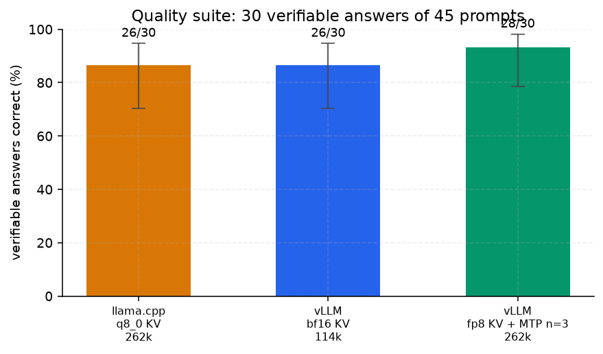
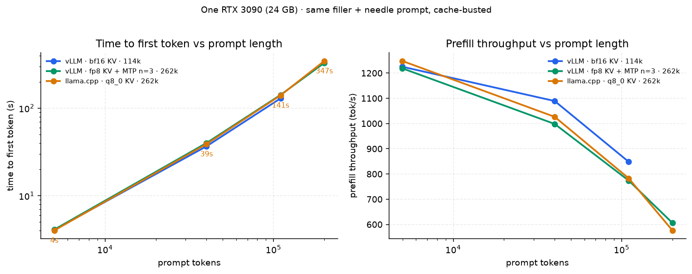
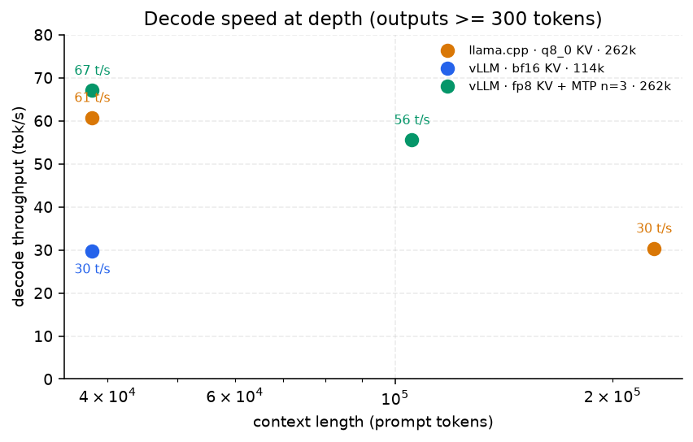
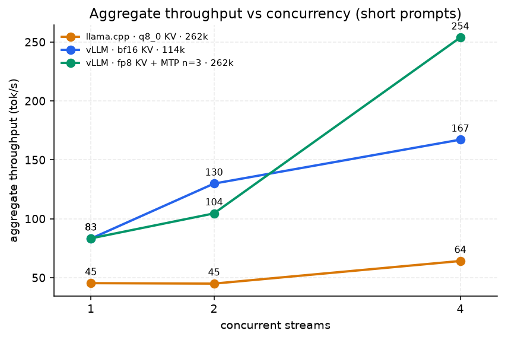

# Running Ternary-Bonsai-2-27B on a single 24 GB RTX 3090: vLLM vs llama.cpp, measured

*A practical, numbers-first field report. All figures below were measured on the machine
described, not estimated. Raw outputs are in [`data/`](data/) and the test scripts in
[`scripts/`](scripts/).*

---

## TL;DR

| | llama.cpp (GGUF, q8_0 KV) | vLLM (bf16 KV) | vLLM **final** (fp8 KV + MTP n=3) |
|---|---|---|---|
| max context / request | **262,144** (native) | 114,688 (bf16 KV limit) | **262,144** (native) |
| KV capacity | 262k shared pool | 119,553 tokens | 262k–294k tokens (1.00–1.12×, boot variance) |
| VRAM | 19.9 GB | 22.5 GB | 23.5 GB |
| prefill speed | ~1,085 tok/s | ~1,118 tok/s | **~1,227 tok/s** (218k prompt in 178 s) |
| decode, short ctx | 84 tok/s | 84 tok/s | **83.3 tok/s** |
| decode, 38k ctx, long output | 60.7 tok/s | 29.7 tok/s | **67.0 tok/s** |
| 2 concurrent long requests | 133 s (2×40k) | **39 s** (2×38k) | 80.3 s (2×57k) |
| 4 concurrent short streams | 64.1 tok/s agg | 167 tok/s agg | **253.8 tok/s agg** |
| TTFT at a ~200k prompt | 347 s | n/a (114k limit) | **330 s** |
| quality, thinking off (30 verifiable) | 26/30 | 26/30 | 28/30 (within noise) |
| quality, thinking on (30 verifiable) | not measured | not measured | **30/30** |
| Qwen3.8-27B original, same suite | — | — | 28/30 off · **30/30 on** (Part 8) |
| needle recall at depth | ✅ 228k | ✅ 95k | ✅ **218,559 tokens** |

> **Update 2026-10-27 — the "vLLM can't do 8-bit KV" finding below is obsolete.**
> The fp8 crash had nothing to do with fp8 or CUDA graphs: it was the *draft depth*
> of the image's baked-in MTP speculative decoding (7 tokens). At
> `num_speculative_tokens: 3`, fp8 KV + full CUDA graphs is stable, and the KV pool
> grows to the native 262,144 tokens at unchanged speed. See **Part 4**.
> The original bf16-only analysis is kept verbatim as a record of the path.

**Use llama.cpp for long-context single-user work on 20 GB of VRAM. Use vLLM (final
config) when you want the same 262k context *plus* batching — it is now the better of
the two on every axis except 1 GB of VRAM.** The engines are equally fast at short
context; they separate only under long context (KV-cache bandwidth) or concurrency.

---

> **Method, in one place.** Every number in this report was produced with the same
> rules, and nothing below deviates from them without saying so:
> **thinking disabled** (`chat_template_kwargs: {"enable_thinking": false}` — `/no_think`
> in the prompt does nothing on the llama.cpp build), **`temperature: 0`** with a fixed
> seed, **cache-busted prompts** (a unique `NONCE-<uuid>` prefix on every request, so no
> engine can answer from its prefix cache), a **needle at the very end** of every long
> prompt to prove the tokens were actually read, a **warm-up request before measuring**,
> and decode throughput measured on **outputs of a few hundred tokens**, never on
> 30–40-token probes. Runs that broke one of these rules are flagged where they appear
> (Part 7 documents three of them producing numbers that looked fine and were wrong).

## Why this exists

Ternary-Bonsai-2-27B (Prism ML's 2-bit ternary Qwen3.8-27B) is a ~27B model that
fits in 24 GB only because its weights are ternary. Serving it at long context is
where things get interesting: KV cache, not weights, becomes the budget.

vLLM support is unofficial and new (`fraserprice/bonsai-vllm`, WIP, "tested on
RTX PRO 6000 Blackwell only"). This report documents what actually works on
Ampere (sm_86), what breaks, and how to get the most context out of 24 GB.

**Hardware:** RTX 3090 24 GB, i7-10700K, 32 GB RAM, Linux.
**Model variants:** `fraserpricee/bonsai-vllm:20260918` (vLLM, `prism_ternary`
quantization) and `Ternary-Bonsai-2-27B-PQ2_0-MTP-Q8_0.gguf` (llama.cpp, with MTP
speculative decoding).

---

## The KV cache math that drives everything

From the engine's own startup log (vLLM, bf16 KV, 32k max-len):

```
Available KV cache memory: 10.45 GiB
GPU KV cache size: 94,391 tokens
Maximum concurrency for 32,768 tokens per request: 2.88x
```

=> **~116 KiB of KV per token.** For a 262k-token context that is **28.6 GiB** —
impossible on a 24 GB card with 16-bit KV. This single fact explains every
trade-off below: context, quantization, and decode speed are all KV-byte problems.

*(Update 2026-10-27: with 8-bit KV the same 262k context costs ~9.7 GiB — the pool now
holds exactly one full-length request. See Part 4.)*

---

## Part 1 — vLLM: what works, what breaks

### Working configuration

```bash
docker run -d --name bonsai-vllm --gpus all --ipc=host -p 8000:8000 \
  -v bonsai:/cache -e PYTORCH_CUDA_ALLOC_CONF=expandable_segments:True \
  fraserpricee/bonsai-vllm:20260918 \
  --max-model-len 114688 --max-num-seqs 64 --gpu-memory-utilization 0.92 \
  --compilation-config '{"cudagraph_capture_sizes":[1,2,4,8,16,32]}'
```

Verified limits on this card (bf16 KV):

| max-model-len | KV memory | KV tokens | concurrency @ max len |
|---|---|---|---|
| 32,768 | 10.45 GiB | 94,391 | 2.88x |
| 98,304 | 9.29 GiB | 115,810 | 1.18x |
| 114,688 | 9.29 GiB | 119,553 | 1.04x |

Note the counter-intuitive detail: **bigger max-model-len does not shrink KV
capacity** (it went *up*: 94k → 119k tokens), because vLLM's profiling reserves
less for CUDA graphs at larger sequence limits. 114,688 is the practical ceiling **for
16-bit KV only** — with fp8 KV the same card reaches the full native 262,144 (Part 4), so
this limit is a property of the KV dtype, not of vLLM or the GPU. Beyond it you exceed
the KV pool.

### Things that do NOT work (with evidence)

1. **fp8 KV cache (`--kv-cache-dtype fp8_e4m3`) with the image's default MTP depth
   (`num_speculative_tokens: 7`)** — starts fine, single requests answer correctly
   (5/7 outputs byte-identical to bf16; the rest diverged only in reasoning path,
   same correct answers). **But under 4+ concurrent requests the engine dies with
   `CUDA error: an illegal memory access`** and force-kills itself. The cause was
   later localized to the speculative-decoding **draft depth**, not to fp8 or to
   CUDA graphs: at `num_speculative_tokens: 3` the same fp8 configuration runs
   stably under 4-way load — see **Part 4**. (Independent confirmations that it was
   not a graph-capture fluke: the crash reproduced with capture sizes `[1,2,4]`,
   with a 512 MB FlashInfer workspace, and with chunked prefill unchanged; x2 never
   crashed, x4 always did.)
2. **turboquant presets (`turboquant_k8v4` etc.)** — startup fails:
   `ValueError: Unknown TurboQuant cache dtype: 'auto'` — hybrid layers request a
   native-dtype cache and the TurboQuant backend raises instead of returning the
   standard shape. Patching that yields a second failure in
   `_reshape_attention_kv_cache` (layout mismatch). Upstream bug, not config.
3. **Blackwell-only testing.** The image is documented as tested on RTX PRO 6000
   only. Ampere surprises (above) are consistent with that.

### Upstream status (checked 2026-10-26)

- Repo `fraserprice/bonsai-vllm`: no commits since 2026-09-18; no releases; one
  published image tag.
- Open PR/issue #1 (2026-10-13): bump base image vLLM 0.25.1 → 0.31.0 (adds
  `cuda-toolkit` + `ninja` for JIT kernels). The author independently reports
  "131k context causes a KV cache mismatch" on a 24 GB RTX 4090 and settles on
  `--max-model-len 65536`. Not merged.

---

## Part 2 — llama.cpp: 262k context on the same card

```bash
llama-server -m models/Ternary-Bonsai-2-27B-PQ2_0-MTP-Q8_0.gguf \
  --host 127.0.0.1 --port 8080 -ngl 99 -fa on \
  -c 262144 --parallel 2 --kv-unified \
  -ctk q8_0 -ctv q8_0 --jinja \
  --spec-type draft-mtp --spec-draft-n-max 2
```

Result: 2 slots × **262,144** (the model's native max, from GGUF
`qwen35.context_length`), shared KV pool, **19,959 MiB VRAM**, needle-in-haystack
recall verified at **228,100 tokens** depth.

### The two llama.cpp gotchas worth knowing

**`-c` is the TOTAL pool, not per request.** With `-c 32768 --parallel 8`, every
chat gets **4,096** tokens — the startup log says it plainly:
`n_slots = 8, n_ctx_slot = 4096`. `--kv-unified` changes the allocation model:
one shared buffer, so a single request may use the entire pool (and concurrent
requests share it dynamically, first-come-first-served).

**KV dtype is f16 unless you say otherwise.** No `-ctk/-ctv` flags = 116 KiB/token,
identical cost to vLLM bf16. `-ctk q8_0 -ctv q8_0` halves it with no measurable
quality loss in our tests, and — importantly — halves the memory traffic per
decoded token, which is why llama.cpp wins long-context decode.

---

## Part 3 — Apples-to-apples benchmark

Method: identical prompts, greedy (`temperature=0`), `max_tokens` fixed,
**thinking disabled on both engines**:

```json
"chat_template_kwargs": {"enable_thinking": false}
```

(`/no_think` as a prompt prefix does **not** work on the llama.cpp build — it
silently keeps generating hidden thinking tokens. The template kwarg works on both.)

| test | llama.cpp | vLLM |
|---|---|---|
| "capital of France" | 8 tok, TTFT 0.11 s | 8 tok, TTFT 0.09 s |
| ~400-token answer | 414 tok, 5.2 s, 84.1 tok/s | 421 tok, 5.1 s, 83.6 tok/s |
| 38k prompt + long answer | TTFT 35.1 s, 558 tok, **60.7 tok/s** | TTFT 34.1 s, 634 tok, **29.7 tok/s** |
| needle at end | ✅ | ✅ |

**A measurement trap we fell into:** the first long-context vLLM run reported
282 tok/s. It was an artifact — 45 tokens delivered in one 0.16 s burst after a
long TTFT. Token rates are only meaningful with **hundreds** of generated tokens.
With real long outputs, vLLM is ~2× slower than llama.cpp at long context —
exactly what you expect when each decoded token must read 2× the KV bytes.

---

## Part 4 — 2026-10-27: 8-bit KV *does* work on Ampere, and vLLM reaches 262k

The question that started this day: *"vLLM only runs these weights at 16-bit — can we
get 8-bit KV or some smarter way to buy context in 24 GB?"* Answer: the 16-bit part
was never the weights, and the fp8 blocker was not fp8.

### 4.1 What the engine is actually running (from its own boot log)

```
Checkpoint size: 9.54 GiB                      # 27B params => ~2.8 bit/param
quantization=prism_ternary  bits=2  group_size=128  hadamard_block=1024
dtype=torch.bfloat16  kv_cache_dtype=auto
WARNING marlin_utils_fp8.py:112 Your GPU does not have native support for FP8
        computation ... Weight-only FP8 compression will be used (Marlin)
```

Weights are already 2-bit ternary; the only 16-bit component is **activations + KV
cache**. On sm_86 there is no native FP8 *compute*, only weight-only FP8 — worth
knowing before chasing lower-precision weights.

### 4.2 The retest matrix (fresh container per row, 400-token greedy load test)

| KV dtype / graphs | KV pool @32k | solo tok/s | x2 agg | x4 agg | 4 parallel |
|---|---|---|---|---|---|
| bf16 + graphs | 94,391 | 83.1 | 129.8 | 167.1 | OK |
| fp8 + graphs (MTP n=7) | 135,952 | 75.1 | 108.0 | — | **IMA, engine dead** |
| fp8 + graphs, capture `[1,2,4]` | 121,311 | 39.0 | 61.3 | — | **IMA, engine dead** |
| fp8 + graphs, 512 MB FI workspace | 135,952 | 74.5 | 114.9 | — | **IMA, engine dead** |
| fp8 + `--enforce-eager` | 138,043 | 27.5 | 42.8 | 100.3 | OK |
| fp8 + compile, `cudagraph_mode=NONE` | 138,043 | 38.0 | 62.9 | 142.8 | OK |

Closed at boot time, not by configuration: `--attention-backend FLASH_ATTN`
(`kv_cache_dtype not supported`), `TRITON_ATTN` (`FP8 KV ... requires SM89+`),
`--no-enable-chunked-prefill` (`Chunked prefill is required for mamba cache mode
'align'`). FlashInfer is the only fp8-KV backend available on this card.

### 4.3 The actual fix: draft depth, not dtype

The image's entrypoint bakes `--speculative-config {"method":"mtp",
"num_speculative_tokens":7}`. Overriding the draft depth is a one-flag change
(a duplicated CLI arg wins) — and vLLM also sizes the KV pool by draft depth:

| n_spec | KV pool @32k | x4 agg | x4 result |
|---|---|---|---|
| 7 (image default) | 135,952 (3.70×) | — | **CUDA IMA, engine dead** |
| **3** | **162,929 (4.97×)** | **246.5 tok/s** | OK |
| 0 (MTP off) | 277,162 (8.46×) | 193.7 tok/s | OK |

MTP is *verified* speculative decoding, so lowering the draft depth changes speed and
memory, never output quality.

### 4.4 Final configuration — 262k context at unchanged speed

```bash
docker run -d --name bonsai-vllm --gpus all --ipc=host -p 8000:8000 \
  -v bonsai:/cache -e PYTORCH_CUDA_ALLOC_CONF=expandable_segments:True \
  fraserpricee/bonsai-vllm:20260918 \
  --max-model-len 262144 --max-num-seqs 64 --gpu-memory-utilization 0.92 \
  --kv-cache-dtype fp8_e4m3 \
  --speculative-config '{"method":"mtp","num_speculative_tokens":3}' \
  --compilation-config '{"cudagraph_capture_sizes":[1,2,4,8,16,32]}'
```

| max-model-len | KV pool | concurrency | measured proof |
|---|---|---|---|
| 32,768 | 162,929 | 4.97× | x4 short-stream load: 246.5 tok/s agg, 0 errors |
| 131,072 | 241,875 | 1.85× | 114,059-token needle ✅ (141 s); 2 × 57,059 parallel ✅ (80.3 s) |
| **262,144** | **262,144** | **1.00×** | **218,559-token needle ✅ (178 s, ~1,227 tok/s prefill)** |

Solo decode at the final config: **83.3 tok/s** — identical to the old bf16+MTP
configuration — while 4-stream aggregate rises from 167.1 to **253.8 tok/s**.

**The honest caveats**

- At 262k the pool is exactly 1.00×: one full-length conversation owns the whole
  cache and other requests queue behind it. Normal traffic is unaffected (262,144 /
  8,000 ≈ 32 concurrent short chats).
- fp8 KV stores K/V at 8-bit: single-request output parity was verified earlier
  (5/7 byte-identical, the rest same answers) and every needle test passed, but it
  is not bit-identical to bf16.
- If you need extra *concurrency headroom* rather than speed, dropping MTP entirely
  (override the entrypoint and omit `--speculative-config`) yields a 311,200-token
  pool (1.19× at 262k) at 58 tok/s solo.
- These weights are **text-only**: the checkpoint contains 0 vision tensors, and the
  engine logs `All limits of multimodal modalities supported by the model are set to
  0, running in text-only mode`. Do not expect image input from this release.
- Detection lesson: when the engine dies, the API server keeps answering
  `/v1/models` for a few seconds and in-flight streams return **zero tokens with no
  client-side exception**. Judge health on `docker inspect` state + `docker logs`,
  never on the health endpoint alone.

---

### 4.5 Choosing the draft depth (n = 1…7)

The draft depth is the single most consequential flag on this image, and it is not a
free parameter: each speculative token costs KV/state memory and only pays off if it
is accepted. Measured, one boot per depth, fp8 KV, 262k context:

| MTP depth | KV pool | solo decode | 4-stream aggregate | status |
|---|---|---|---|---|
| n=1 | 304,087 | 71.4 tok/s (3 runs, ±0.2) | 252.1 tok/s | stable |
| n=2 | 299,380 | 79.7 tok/s | 240.0 tok/s | stable |
| **n=3** | **294,362** | **82.7 tok/s (3 runs, ±0.1)** | **253.8 tok/s** | **stable — best** |
| n=4 | — | — | — | **cannot boot at 262k**: needs 9.48 GiB of KV, 9.3 GiB available |
| n=5 | 283,514 | 79.0 tok/s | 0 (HTTP 500) | unstable under 4 streams |
| n=7 | — | — | — | crashes under load (illegal memory access) — the original "fp8 bug" |

Two mechanisms explain the shape. First, acceptance: the MTP head lands roughly 2–3
tokens per draft on this model, so drafts deeper than that are mostly discarded work.
Second, memory: every extra draft slot shrinks the KV pool (304k → 294k → 283k tokens),
and at n=4 the pool can no longer cover a 262k request at all.

So the honest statement is: **n=3 is the best depth *that is stable at 262k* on this
card** — 16% faster than n=1 in a repeated solo measurement (82.7 vs 71.4 tok/s), best
four-stream throughput, and the deepest setting that still fits. If you drop the
context limit, n=4 becomes bootable, but you trade 65k of context for a draft that
acceptance will mostly reject. If you need maximum KV headroom instead of speed,
`bonsai-vllm vllm-max` (no MTP at all) gives 311,200 tokens at 58 tok/s solo.

## Part 5 — Does quantized KV cost quality? Measured, not asserted

A memory saving that silently degrades answers is not a saving. So we ran the same
45 prompts through all three configurations: temperature 0, seed 42, thinking
disabled, identical chat template, `max_tokens` high enough that nothing was cut.
Thirty of those prompts have a verifiable answer (a number, a name, a yes/no), which
is what the scores below use; the rest are open-ended and only compared textually.

| configuration | verifiable answers | accuracy |
|---|---|---|
| llama.cpp, q8_0 KV, 262k | 26 / 30 | 87% |
| vLLM, bf16 KV, 114k | 26 / 30 | 87% |
| vLLM, fp8 KV + MTP n=3, 262k | 28 / 30 | 93% |



The bars look ordered, the ordering is not real: with n=30 the Wilson 95% intervals
are roughly 70–95% (26/30) and 79–98% (28/30) — they overlap almost completely. **On
this suite we cannot distinguish the three configurations.** The two answers that
separate fp8 from bf16 are one arithmetic slip (`17.5% of 240`: fp8 answered 42, the
others 36) and one reasoning chain that reached Friday instead of stopping at
Wednesday. Both are model behaviour, not KV precision.

Textually, the copies are near-identical:

- bf16 vs llama.cpp: mean similarity 0.993, 43 of 45 answers byte-identical
- bf16 vs fp8: 0.912, 38 of 45 identical
- fp8 vs llama.cpp: 0.916, 39 of 45 identical

The three prompts everybody failed are more interesting than the ones they got right:
`'5' + '3'` came back as `8` in all three (it treats it as arithmetic), "a sentence
about rain without the letter e" produced *"Rain falls on the ground."* in all three
(there is an `e` in "the"), and the classic mislabelled-boxes puzzle was solved
correctly by everyone once given room to reason.

**What this does not prove.** Thirty prompts, one seed, no multi-turn, no tool
calling, no multilingual depth beyond a few translations. It is enough to say "we
found no quality cost from fp8 KV or q8_0 KV on this model", not enough to say
"numerically equivalent". Anyone who needs the latter should run MMLU-style evals at
scale — the harness in `scripts/quality_eval.py` is shaped for exactly that.

## Part 6 — Where the time goes: TTFT, prefill, decode, concurrency

Every point below comes from the same protocol: one filler document, a needle at the
very end, a 40-token answer, **thinking off**, and a unique nonce prefix so no prompt
can hit a cache (see Part 7 — this matters more than it sounds).

| prompt tokens | llama.cpp q8_0 | vLLM bf16 | vLLM fp8 + MTP n=3 |
|---|---|---|---|
| ~5k | 4.0 s · 1248 t/s | 4.1 s · 1225 t/s | 4.1 s · 1219 t/s |
| ~40k | 39.0 s · 1026 t/s | 36.7 s · 1089 t/s | 40.1 s · 998 t/s |
| ~110k | 140.5 s · 783 t/s | 129.7 s · 848 t/s | 142.1 s · 774 t/s |
| ~200k | 347.1 s · 576 t/s | — (114k ceiling) | 330.1 s · 606 t/s |



Prefill starts around 1.2k tokens/s for all three and decays to ~600 tokens/s at
200k tokens — the attention term, not the KV dtype, is what costs you at depth. What
fp8 buys is not speed at a given length; it is **reaching the length at all**.

Decode is where the configurations genuinely separate:



At 38k, bf16 KV decodes at 29.7 t/s while fp8 KV does 67.0 t/s on the same card with
the same weights — same effect that makes llama.cpp's q8_0 KV fast: half the bytes
read per token. llama.cpp sits at 60.7 t/s at 38k and falls to 30.3 t/s at 228k.

Concurrency is where vLLM earns its complexity:



llama.cpp barely scales (45.3 → 64.1 t/s) because it processes slots the old way;
vLLM bf16 reaches 167 t/s at four streams, and fp8 + MTP n=3 reaches 253.8 t/s —
about 3× the single-stream rate. If you are serving several clients, that difference
is the whole argument for vLLM.

## Part 7 — Measurement traps (the ones that nearly fooled us)

These are not footnotes. Three of them produced numbers that looked plausible and
were simply wrong.

**1. Prefix caching silently fakes your prefill numbers.** Our first sweep reported
36,911 tokens/s at 40k. It was vLLM answering from the prefix cache in 1.1 s. Every
prompt now begins with a unique `NONCE-<uuid>` so no block can match. If you benchmark
vLLM without cache-busting, your long-context numbers are fiction.

**2. Short outputs make speculation look faster than the GPU can go.** A 40-token
probe at 200k reported 291 tokens/s decode. With a 320-token output the same point
measures **55.5 t/s**. MTP finishes short answers in a couple of draft steps; the
per-token rate is dominated by the first step. Measure decode with outputs of at
least a few hundred tokens.

**3. The first request after boot is not representative.** The same 5k prompt measured
585 t/s cold and 1219 t/s once warm — graph capture and lazy init were still happening.
We now send a throwaway request before measuring.

**4. The KV pool size changes between boots.** fp8 reported 262,144 tokens on one boot
and 294,362 on the next (1.00× vs 1.12×); bf16 reported 128,392 and 144,982. Quoting a
single number implies a precision the allocator does not have — we quote ranges.

**5. Hidden thinking tokens count as completion tokens.** With `--reasoning-parser
qwen3`, a "32-token answer" was 9 visible tokens plus 23 that were stripped before
display. Non-streaming clients see a token count that does not match what they read.

**6. The two engines disagree about the tokenizer endpoint.** vLLM's `/tokenize`
wants `{"prompt": ...}`, llama.cpp's wants `{"content": ...}`; the wrong key returns an
empty list rather than an error, which is how we got a division by zero instead of a
measurement.

## Pinned environment

Numbers like these are only reusable if the versions are pinned. This is the exact
stack behind every measurement above:

- **GPU:** NVIDIA RTX 3090, 24,576 MiB, compute capability 8.6 (Ampere)
- **Driver / CUDA:** 595.58.03 / CUDA 13.2 (host), CUDA 13.0.2 (container)
- **vLLM image:** `fraserpricee/bonsai-vllm:20260918`, digest
  `sha256:a40d14f5eb218d80984d5009a61262668f9665f2f2946b84bd3c0102f1fc85e9`, vLLM 0.25.1
- **llama.cpp:** build 10709, commit `9a9394a89`, custom build including the Hadamard
  MTP fix (see Part 2), model `Ternary-Bonsai-2-27B-PQ2_0-MTP-Q8_0.gguf`
- **vLLM final flags:** `--max-model-len 262144 --max-num-seqs 64
  --gpu-memory-utilization 0.92 --kv-cache-dtype fp8_e4m3
  --speculative-config '{"method":"mtp","num_speculative_tokens":3}'
  --compilation-config '{"cudagraph_capture_sizes":[1,2,4,8,16,32]}'`
- **llama.cpp flags:** `-c 262144 --parallel 2 --kv-unified -ctk q8_0 -ctv q8_0
  --flash-attn on --spec-type draft-mtp --spec-draft-n-max 2`

> **Copy the whole command, not part of it.** The image's entrypoint already bakes in
> `--speculative-config '{"method":"mtp","num_speculative_tokens":7}'` — the depth that
> crashes under load. Anything you pass on `docker run` is appended and wins (vLLM logs
> `Found duplicate keys` and takes the later value). Pass the full flag set above, or
> verify what is actually running: n=3 shows ~83 tok/s solo and a 294k-token KV pool,
> n=1 shows ~71, and n=7 crashes under four concurrent streams.

## What we would do differently

- **Measure quality before tuning speed.** We spent two days on KV dtypes with no
  evidence about what they did to answers. The eval harness took an afternoon and
  would have framed every earlier decision.
- **One harness, not five.** `ab_kv_test.py`, `test_max_ctx.py`, `test_vllm_max.py`,
  `a2a_test.py` and `load_sweep.py` all grew separately and disagreed about units.
  `ttft_sweep.py` and `quality_eval.py` replace them.
- **Treat speculative-decoding depth as a first-class parameter.** It caused the
  crash we blamed on fp8, and it distorts short-output benchmarks.
- **Write down boot variance from day one.** The KV pool number is not a constant.
- **Log the config next to the number**, always — half the confusion in our own notes
  came from tables whose flags were recorded three paragraphs away.

## FAQ

**Will this work on a 4090?** Almost certainly the same shape — same 24 GB, same
compute capability 8.9 — but we have not measured it, so we do not claim it. The KV
math is identical; the bandwidth is higher, so decode should be faster.

**And on an A6000 (48 GB)?** Yes, and comfortably: 262k at bf16 KV is ~28.6 GiB, which
fits with the weights on a 48 GB card without any KV quantization.

**Why not just run a 70B?** A 70B at 4-bit is ~40 GB of weights before any KV cache.
On 24 GB it does not fit, at any context length.

**Is fp8 KV actually safe?** On this model and this image, under concurrency, with
MTP at n=3: yes, measured, no degradation we could detect in 45 prompts. Keep bf16 if
you want zero novelty in the stack and can live with 114k instead of 262k.

**Which should I use for an agent backend?** vLLM: OpenAI-compatible API, 3×
throughput at four streams, spec decoding on. But be aware we did not test tool
calling or multi-turn behaviour — that is the obvious next report.

**Can I reproduce all of this?** Yes: `scripts/` has the harnesses, `data/` has the raw
JSON from every run, and the pinned versions above are the ones that produced them.

## Part 8 — What does 2-bit actually cost? Compared against the original

Everything above compares three ways of running the *compressed* model. It never
answers the question a reader actually has: what would the original weights have done?

The answer is in the model's own metadata — the GGUF declares
`base_model = Qwen/Qwen3.8-27B`. That model is served on OpenRouter, so it can be
measured with the same 45 prompts, with the provider pinned so routing cannot change
under us: **DeepInfra for bf16**, **Chutes for fp8**, both at 262k context. Total cost
of the whole matrix: **$0.10**, zero errors, provider verified in every response.

| weights | thinking off | thinking on |
|---|---|---|
| Qwen3.8-27B **bf16** (DeepInfra) | 28/30 | **30/30** |
| Qwen3.8-27B **fp8** (Chutes) | 28/30 | **30/30** |
| **Ternary 2-bit**, local, fp8 KV | 28/30 | **30/30** |
| Ternary 2-bit, local, bf16 KV | 26/30 | not measured |
| Ternary 2-bit, llama.cpp q8_0 | 26/30 | not measured |

**Two findings, and they point in opposite directions from what we assumed.**

First, **the compression is invisible on this suite.** The 7.1 GB ternary build scores
exactly what the bf16 original scores — at both thinking settings. Whatever the 2-bit
weights cost, it is not measurable in 30 verifiable answers.

Second, **thinking mode is the entire difference**, and it is worth exactly the two
answers the ternary build was missing: 28/30 → 30/30, on the original *and* on the
compressed model. It is also not free: `a1` went from 39 to 98 completion tokens, so
roughly 2.5× the decode work, which at 262k context is a real bill.

The four disagreements, all of them, when both run without thinking:

- `(47 × 13) − (96 / 4)` — original answered **605** (wrong); ternary wrote out
  `611 − 24 = 587` and got it right
- 80 € −25% +21% — original answered **63.00** (wrong); ternary showed `60 × 1.21`
  and got **72.60**
- `print('5' + '3')` — original answered **53** (right); ternary answered **8**
- "a sentence about rain without the letter e" — original wrote *"Rain falls on dry
  soil."* (right); ternary wrote *"Rain falls on the ground."*

Net zero. The pattern is not "compressed model is dumber" — it is "without thinking,
the original takes shortcuts and slips on arithmetic, while the ternary build writes
its work out and slips on strict string constraints instead".

**Serving precision is a wash too.** bf16 and fp8 versions of the original agree on
0.937 of answer text (38/45 byte-identical) with identical scores, so nothing observed
here is attributable to fp8.

**Long context, checked against the original rather than self-reported.** Same needle
at the end of the document, Chutes fp8, provider-pinned:

| prompt tokens | wall time | needle recovered |
|---|---|---|
| 20,526 | 3.7 s | ✅ |
| 102,587 | 13.9 s | ✅ |
| 205,164 | 34.2 s | ✅ |

Those wall times are a warm datacenter GPU and are **not** comparable to the 330 s this
card needs at 200k — they only establish that the original behaves normally at depth,
so the 262k window is not a ternary trick.

**Three caveats worth as much as the result.** (1) With thinking enabled locally, every
answer arrived with an empty `reasoning_content` — the chain was generated and
discarded, so we score the answer but cannot inspect the reasoning (the Part 7 trap,
now costing us observability instead of accuracy). (2) n=30, one seed: this detects a
large regression, not a 3% one. (3) The original was measured on third-party providers
we can verify by name but cannot audit.

## Decision guide

- **Maximum context, both engines now reach it** → vLLM final config (262k + batching) or
  llama.cpp (262k, 1 GB less VRAM, faster long-context decode).
- **Long documents, single user** → llama.cpp still wins decode at depth (60.7 vs 29.7
  tok/s at 38k, bf16-KV vLLM measurement; the fp8 config has not been re-measured there).
- **Several users / chat UI / batching** → vLLM final config (253.8 tok/s agg at 4 streams).
- **Short-context throughput** → either; they are within 1% of each other.
- **Do not** use fp8 KV with `num_speculative_tokens: 7` on Ampere, and skip
  turboquant presets until the upstream fix lands.

---

## Reproduce it

- `scripts/ab_kv_test.py` — bf16 vs fp8 KV A/B (outputs + TTFT + t/s + load test)
- `scripts/test_vllm_max.py` — vLLM max-context needle + concurrency
- `scripts/test_max_ctx.py` — llama.cpp max-context needle (228k depth)
- `scripts/a2a_test.py` — apples-to-apples harness (`vllm` | `llama`)
- `scripts/load_sweep.py` — x2/x4 short-prompt concurrency sweep (`load_sweep.py <label> 2,4`)
- `scripts/long_conc.py` — N simultaneous long prompts with a per-stream needle
  (`long_conc.py <label> <n> <tokens>`) — this is the run that proves real multi-session
  capacity, not just a short-prompt load test
- `scripts/sweep_seqs.sh` — boot-only sweep of `--max-num-seqs` / `--max-num-batched-tokens`
  (both turned out **not** to change the KV pool on this model)
- `data/` — raw JSON results, `RESULTS.md` lab notebook, launch script
- [`TIMELINE.md`](../TIMELINE.md) — the day-by-day path, including the ruled-out hypotheses

---

## Credits

This work builds entirely on other people's work; full attribution with links is in
[`CREDITS.md`](CREDITS.md). In short:

- **Model:** Ternary-Bonsai-2-27B by [Prism ML](https://prismml.com/) — ternary
  (~2-bit) weights, based on the **Qwen3.8-27B** architecture from the Qwen team
  (Alibaba). The BF16 **MTP head** used for speculative decoding comes from the same
  Qwen3.8-27B release; every drafted token is verified by Bonsai.
- **vLLM path:** the `prism_ternary` plugin, custom CUDA kernels, model converter and
  docker image are by **fraserprice** ([fraserprice/bonsai-vllm](https://github.com/fraserprice/bonsai-vllm),
  unofficial and WIP, not affiliated with Prism ML), built on
  **[vLLM](https://github.com/vllm-project/vllm)** and its
  **[FlashInfer](https://github.com/flashinfer-ai/flashinfer)** attention backend.
- **llama.cpp path:** **[ggml-org/llama.cpp](https://github.com/ggml-org/llama.cpp)** —
  `llama-server`, KV-cache quantization and MTP speculative decoding; GGUF packaging
  credited to **ProCreations** as noted in the launch script.
- **Measurement:** dependency-free Python stdlib harnesses, Docker + NVIDIA Container
  Toolkit, Hugging Face Hub for weights and caching.
- **Hardware:** RTX 3090 (24 GB, sm_86) — all numbers in this report were measured
  there, not on the Blackwell card the upstream image was validated on.

If you reuse this material, keep these credits and link back to the authors. Bugs in
the vLLM plugin belong upstream in `fraserprice/bonsai-vllm`.

